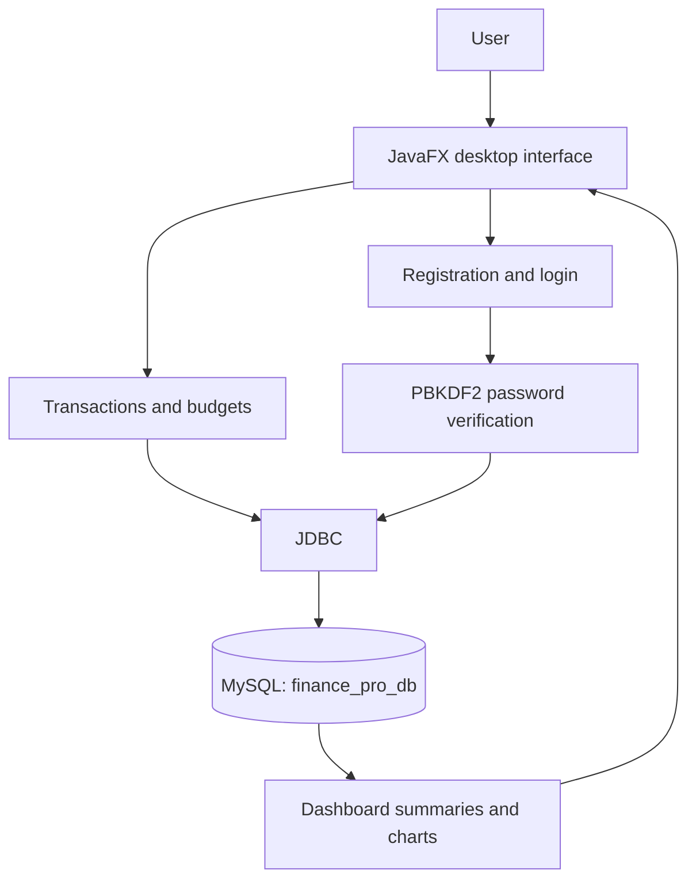

# Finance Pro — Personal Finance Management

A JavaFX desktop application for recording income and expenses, managing monthly category budgets, and reviewing financial summaries and charts. The application uses MySQL for persistent storage and JDBC for database access.

> **Project status:** Academic / portfolio project. This is a local desktop application, not a production banking service. Do not use real financial data until the remaining security and deployment work has been independently reviewed.

## Features

- User registration, sign-in, and logout.
- Password hashing with PBKDF2-HMAC-SHA256 (210,000 iterations and a unique random salt per password).
- Automatic upgrade of existing legacy plaintext passwords after a successful login.
- Disables the old predictable `admin / admin123` demo account when the application starts.
- Income and expense transaction entry, categories, date selection, filtering, and search.
- Monthly budgets by spending category, including spent, remaining, and status values.
- Dashboard summaries for total, daily, and monthly income and expenses.
- Expense breakdown pie chart and six-month income-versus-expense bar chart.
- Budget health, savings-rate, cash-flow, and top-spending indicators.
- Notifications / quick statistics and dark/light theme switching.

## Technology stack

| Area | Technology |
| --- | --- |
| Language | Java 21 |
| Desktop UI | JavaFX |
| Database | MySQL |
| Database access | JDBC |
| MySQL driver | MySQL Connector/J 8.4.0 (project configuration reference) |
| Build / IDE | Apache Ant / NetBeans |
| Password hashing | Java Cryptography Architecture (PBKDF2-HMAC-SHA256) |

## Architecture



The JavaFX application handles the user interface. JDBC connects it to MySQL. Passwords are salted and hashed in the application before storage; authentication verifies the hash rather than comparing a submitted password directly with a database value.

## Repository structure

```text
advanced-FinanceAp/
├── src/
│   └── financeapp/
│       └── FinanceApp.java
├── nbproject/
│   ├── project.properties
│   └── project.xml
├── build.xml
├── manifest.mf
└── README.md
```

## Prerequisites

- JDK 21.
- MySQL Server.
- MySQL Connector/J compatible with the version referenced by the project.
- NetBeans with Java / JavaFX support, or an equivalent JavaFX and Ant build setup.
- A dedicated MySQL development account with permission to create the application database and tables.

## Database configuration

The application reads database settings from environment variables:

| Variable | Required | Default | Purpose |
| --- | --- | --- | --- |
| `FINANCE_DB_HOST` | No | `localhost` | MySQL host |
| `FINANCE_DB_USER` | No | `finance_app` | MySQL username |
| `FINANCE_DB_PASSWORD` | Yes | None | MySQL password |

The database name is `finance_pro_db`; the application uses port `3306`. On startup, it attempts to create the database and the `users`, `transactions`, and `budgets` tables if they do not exist. The database account therefore needs the required database/table creation permissions during initial setup. For a deployed environment, prefer a DBA-managed schema and a least-privilege runtime account.

**Windows PowerShell**
```powershell
$env:FINANCE_DB_HOST = "localhost"
$env:FINANCE_DB_USER = "finance_app"
$env:FINANCE_DB_PASSWORD = "your-local-database-password"
```

**macOS / Linux**
```bash
export FINANCE_DB_HOST=localhost
export FINANCE_DB_USER=finance_app
export FINANCE_DB_PASSWORD='your-local-database-password'
```

Set these variables in the terminal or launch configuration used to start the application. Never put real credentials in Java source code, screenshots, commits, or this README.

The NetBeans project configuration references a local MySQL Connector/J JAR path. If that path does not exist on your computer, download the driver and update the library reference in `nbproject/project.properties` to your own local driver location. Do not commit machine-specific absolute paths or the JAR itself.

## Run the application

1. Install and start MySQL Server.
2. Create a dedicated local MySQL account and grant only the permissions needed for initial database/table setup.
3. Set `FINANCE_DB_HOST`, `FINANCE_DB_USER`, and `FINANCE_DB_PASSWORD` in your environment.
4. Install JDK 21 and configure JavaFX support in NetBeans.
5. Add MySQL Connector/J to the project's compile classpath.
6. Open the repository as an existing NetBeans project.
7. Build and run the project using NetBeans / its Ant project actions.

If the database connection fails, check that MySQL is running, the environment variables are set in the same process environment as NetBeans, and the database account has the required permissions.

## Main data model

| Table | Purpose | Key fields |
| --- | --- | --- |
| `users` | Application accounts | `id`, `username`, `password`, `full_name` |
| `transactions` | Income and expense records | `user_id`, `type`, `category`, `amount`, `transaction_date` |
| `budgets` | Monthly category budgets | `user_id`, `category`, `amount`, `month_year` |

Transactions and budgets are associated with a user through `user_id`.

## Security notes and limitations

- New passwords are stored as PBKDF2-HMAC-SHA256 hashes with per-password random salts. The Java implementation uses 210,000 iterations.
- Existing plaintext passwords are upgraded to hashes when the corresponding user successfully signs in.
- The known default demo credential `admin / admin123` is disabled at startup if it is still present in an existing local database. Create a new account to use the application.
- Database credentials are read from environment variables rather than hard-coded in the Java source.
- Use a dedicated least-privilege MySQL account; do not run the application with a database administrator account.
- This project has not yet been independently security-audited. Before production use, add automated tests for authentication and authorization, review transaction ownership checks, configure managed secrets and TLS, and test database backup/recovery.
- Do not use this academic project to store real financial information until the remaining security work has been completed.

## Future improvements

- Add automated unit and integration tests for authentication, transaction ownership, and budget calculations.
- Add CSV / PDF transaction exports and date-range reports.
- Add savings goals and configurable budget alerts.
- Provide a portable dependency setup and a documented database setup script.
- Add application screenshots and a short demonstration video.
