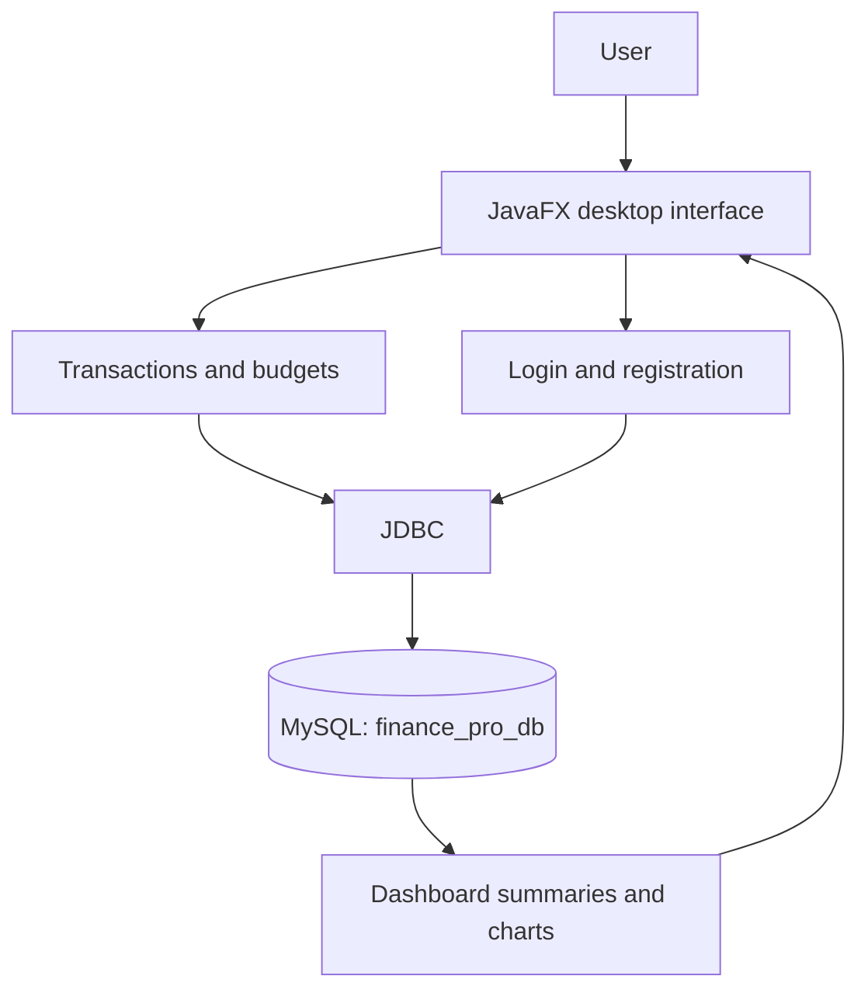

# Finance Pro — Personal Finance Management

A JavaFX desktop application for recording personal income and expenses, managing monthly category budgets, and reviewing financial summaries and charts. The application uses MySQL for persistent storage and JDBC for database access.

> **Project status:** Academic / portfolio project. The current source is a desktop prototype. Review the security and setup notes below before using real financial or personal data.

## Contents

- [Overview](#overview)
- [Features](#features)
- [Technology stack](#technology-stack)
- [Architecture](#architecture)
- [Repository structure](#repository-structure)
- [Prerequisites](#prerequisites)
- [Database configuration](#database-configuration)
- [Run the application](#run-the-application)
- [Main data model](#main-data-model)
- [Security and limitations](#security-and-limitations)
- [Future improvements](#future-improvements)

## Overview

Finance Pro provides a desktop workspace for tracking transactions and budgets. Users can create an account, record income and expenses, set monthly category limits, and review dashboard summaries. The dashboard includes an expense breakdown pie chart and a six-month income-versus-expense bar chart.

## Features

The current Java source implements:

- User registration, sign-in, and logout.
- Income and expense transaction entry.
- Transaction categories, date selection, filtering, and search.
- Monthly budgets by spending category.
- Budget usage, amount spent, remaining amount, and status indicators.
- Dashboard summaries for total, daily, and monthly income and expenses.
- Expense breakdown pie chart.
- Six-month income-versus-expense bar chart.
- Budget health, savings-rate, cash-flow, and top-spending indicators.
- Notifications / quick statistics.
- Dark and light theme switching.
- MySQL database initialization and sample data seeding.

## Technology stack

| Area | Technology |
| --- | --- |
| Language | Java 21 |
| Desktop interface | JavaFX |
| Database | MySQL |
| Database access | JDBC |
| MySQL driver | MySQL Connector/J 8.4.0 (project configuration reference) |
| Project configuration | Apache Ant / NetBeans |

## Architecture



The JavaFX application manages the user interface and application flow. JDBC connects the application to MySQL, where user, transaction, and budget records are stored. Dashboard values and charts are populated from database queries.

## Repository structure

```text
advanced-FinanceAp/
├── src/
│   └── financeapp/
│       └── FinanceApp.java
├── nbproject/
│   ├── project.properties
│   └── project.xml
├── build.xml
├── manifest.mf
└── README.md
```

## Prerequisites

- JDK 21.
- MySQL Server (local development instance).
- MySQL Connector/J compatible with the version referenced by the project.
- NetBeans with Java / JavaFX project support, or an equivalent JavaFX and Ant build setup.
- A MySQL account permitted to create the application database and tables.

## Database configuration

The current source configures:

- Database name: `finance_pro_db`
- MySQL host: `localhost`
- MySQL port: `3306`
- Tables: `users`, `transactions`, and `budgets`

On startup, the application attempts to create the database and required tables if they do not already exist. The source currently contains database connection values directly in `FinanceApp.java`. Configure these for your local MySQL installation before running the application. Do not commit real database passwords.

The NetBeans project configuration references a local MySQL Connector/J JAR path. If that path does not exist on your computer, download the driver and update the library reference in `nbproject/project.properties` to your own local driver location. Do not commit machine-specific absolute paths.

## Run the application

1. Install and start MySQL Server.
2. Create or select a local MySQL development account with permission to create the `finance_pro_db` database and tables.
3. Configure the database host, username, and password in the application source for your local environment.
4. Install JDK 21 and configure JavaFX support in NetBeans.
5. Add the MySQL Connector/J JAR to the project's compile classpath.
6. Open the repository as an existing NetBeans project.
7. Build and run the project using NetBeans / its Ant project actions.

The application creates the database tables on startup when the configured database connection succeeds.

## Main data model

| Table | Purpose | Key fields |
| --- | --- | --- |
| `users` | Application accounts | `id`, `username`, `password`, `full_name` |
| `transactions` | Income and expense records | `user_id`, `type`, `category`, `amount`, `transaction_date` |
| `budgets` | Monthly category budgets | `user_id`, `category`, `amount`, `month_year` |

Transactions and budgets are associated with a user through `user_id`.

## Security and limitations

**Important: address these items before using real financial information or presenting the application as production-ready.**

- The current source compares the supplied password directly with the stored password. Passwords are not currently hashed. Implement a password-hashing algorithm such as BCrypt before using real accounts.
- The source initializes a predictable demo administrator account. Remove or securely replace this initialization before sharing a deployed build.
- Database credentials are currently hard-coded in the Java source. Move them to environment-based or external configuration and keep secrets out of Git.
- Review database permissions and use a dedicated least-privilege database account instead of a root account.
- Add automated tests for authentication, transaction ownership, budget calculations, and database errors.
- The repository currently uses a local Connector/J JAR reference; make setup portable for other developers.

## Future improvements

- Hash passwords and improve account/session security.
- Move database configuration outside source code.
- Add transaction export (CSV / PDF) and date-range reports.
- Add savings goals and configurable budget alerts.
- Add automated unit and integration tests.
- Provide a portable dependency setup and a documented database setup script.
- Add application screenshots and a short demonstration video.
